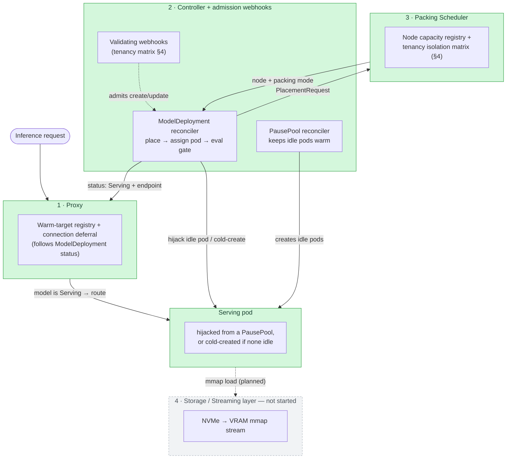

# Amphora

**Private GPU Fleet & Inference Economics Platform**

Amphora is an open-core Kubernetes operator + proxy + serving fabric that lets enterprises run
private LLM fleets with fast, bandwidth-bound cold starts, tenancy-certified multi-tenant GPU
packing (MIG/time-slicing), live cost & utilization observability, and an enforced (not just
logged) EU AI Act-grade audit trail.

> Status: **early development, not production-ready.** The control path works end to end on a
> real Kubernetes cluster (admission, placement, pod assignment, quality gate, routing), but it
> has only ever run against a GPU-less stub model: nothing here has been validated on real GPUs,
> MIG, or large models yet, and the storage/streaming layer and the audit trail are not built. See [What works today](#what-works-today) and the
> [roadmap](#roadmap).

## Architecture



A **Cost & Audit Plane** cuts across all four components in the Technical Specification. Only its
first piece exists today: the proxy tags each routed request with model/tenant headers. The WORM
audit trail, cost accounting, and region tagging are not built.

The Proxy and Controller are decoupled through the `ModelDeployment` status rather than a
separate RPC channel: the controller publishes `status.endpoint` only while a deployment is
`Serving`, and the proxy (run with `-sync-from-cluster`) watches those objects. There is no
gRPC link, so there is also no proxy → controller wakeup path yet (nothing scales to zero).

## What works today

All of this is covered by unit/envtest tests and a kind-cluster end-to-end suite
(`make test-e2e`, 24 specs, also run in CI):

- **`ModelDeployment` CRD** (`amphora.amphora.sh/v1alpha1`) with an immutable `tenancyClass`
  (`SingleTenant` / `TrustedMultiTenant` / `RegulatedMultiTenant`), `gpuFraction` (MIG profile),
  `allowedRegions`, and `evalGate`.
- **Admission webhooks** (`ModelDeployment`, `PausePool`) that reject at create/update: a
  regulated spec without a MIG `gpuFraction` or `allowedRegions`, malformed MIG profiles, and
  slice/tenancy combinations that violate the §4 matrix. They reuse the scheduler's own rules.
  Failure policy is `Fail`.
- **Packing Scheduler**: best-fit VRAM bin-packing that independently enforces the tenancy
  isolation matrix at placement time (defense in depth with the webhook).
- **Data residency** (`allowedRegions`): placement only onto nodes whose standard
  `topology.kubernetes.io/region` label is listed, failing closed (an unlabeled node never
  matches). It is re-checked on every reconcile: if the spec changes or a node is relabeled so a
  running deployment is out of region, its pod is deleted, traffic stops, and it is re-placed.
- **Pause-pod pool**: a `PausePool` CRD keeps a fixed number of idle, node-pre-bound pods warm per
  node/tenancy/slice. A scheduled deployment **hijacks** an idle pod in place (image swap plus a
  model annotation read through the downward API), and the pool refills. If no pool has an idle
  pod, the controller **cold-creates** a pod instead, counted by
  `amphora_controller_cold_create_fallbacks_total`.
- **Eval gate** before any traffic flip: the pod must be Ready and pass a health probe within
  `timeoutMillis`, and, if `canaryConfigMapRef` is set, answer every canary prompt exactly as
  expected (`/v1/completions`, exact match). It **fails closed**: a failed pod is deleted, and
  after 3 consecutive failures promotion pauses until an operator approves. Without canaries only
  latency is checked and `QualityVerified` stays `False`.
- **Proxy** with connection deferral (requests for a model that exists but is not warm yet are held
  open rather than failed; a model that does not exist is an immediate `404`, and the number of
  parked requests is capped per model and overall, shedding load with `503` + `Retry-After`),
  namespace-qualified model keys (`X-Amphora-Model: <namespace>/<name>`), and routing only
  to deployments that have passed the gate.
- **Client identity at the proxy** (spec §5 Spoofing/Repudiation). With `-tls-cert`, `-tls-key` and
  `-tls-client-ca`, callers must present a certificate signed by that CA. The tenant is taken from
  the verified certificate's common name, not the `X-Amphora-Tenant` header, and a tenant may only
  reach models in its own namespace (`<tenant>/<name>`): another tenant's model, a spoofed tenant
  header, and a nonexistent model of another tenant all get the same `403`, and a caller with no
  certificate gets `401`. The serving certificate is re-read on change, so cert-manager rotation
  needs no restart. `/healthz` and `/metrics` stay reachable without a client certificate.
  Without `-tls-client-ca` the proxy logs that the tenant header is client-asserted.
- **Encrypted, authenticated transport to model pods** (opt-in, spec §5): with
  `--pod-tls-sidecar-image`, every serving pod carries a small TLS-terminating sidecar
  (`amphora-podtls`) that accepts only callers presenting a certificate from the cluster CA with an
  allow-listed identity (the proxy and the controller), then forwards to the model on loopback and
  streams responses unbuffered. The model image is untouched. The proxy and the controller's eval
  gate reach pods over mutual TLS, verifying a per-tenant serving certificate
  (`<namespace>.model.amphora.internal`) from the fixed-name Secret `amphora-model-tls` in each
  tenant namespace, which cert-manager issues (`config/podtls`). A namespace without that Secret
  fails closed: its pods stay in `ContainerCreating` instead of serving plaintext. Pair it with
  `config/podtls/tenant/model-pod-ingress-tls.yaml` so only the sidecar port is reachable.
- **Model-pod ingress policy**: `config/networkpolicy/model-pod-ingress.yaml` restricts connections
  to model pods to the `amphora-system` namespace, so a pod cannot bypass the proxy (and its
  identity checks, tagging and audit) by calling a model pod's IP directly. Apply it in every
  namespace that holds `ModelDeployment`s; it is not applied by the controller.

## Known limitations

- **No real-GPU validation.** The e2e uses a stub model server and maps the `nvidia`
  RuntimeClass to `runc`. MIG, time-slicing, and vLLM behavior are untested.
- **Residency depends on node labels and is narrow.** Nodes must carry
  `topology.kubernetes.io/region`; without it, region-constrained deployments stay `Pending`.
  Eviction when a deployment drifts out of region is abrupt (no drain), and only
  `ModelDeployment` placement is covered (not failover across clusters, which does not exist yet).
- **Scheduler state is in memory.** After a controller restart (or a new leader), the scheduler's
  placements are rebuilt from the cluster before the first placement decision: every running
  deployment is re-adopted at the node its pod actually occupies, validated against the same
  tenancy, region and capacity rules, and one that no longer fits is evicted and re-placed. The
  state itself is not persisted, so this relies on pod labels and node state being readable, and
  there is no handoff of scheduler state between replicas.
- **Quality checking is exact-match only.** Embedding-similarity and judge-model matchers from the
  spec are not implemented, and one shared deadline covers the health probe plus all canaries.
- **Pools are single-namespace** and statically sized; there is no cross-namespace sharing and no
  predictive sizing.
- **Transport to model pods is plaintext unless the TLS sidecar is enabled** (it is opt-in and
  needs cert-manager and a per-namespace serving certificate). With it, identity is **per tenant
  namespace, not per pod**: a compromised pod holds its namespace's serving key and can impersonate
  that tenant's other pods (never another tenant's, and the proxy only routes a tenant's models to
  that tenant). It also adds a loopback hop and a small container per pod. The controller and
  scheduler share a process and proxy <-> controller goes through the Kubernetes API, so there is
  no further internal hop to secure.
- **Scale-to-zero and a proxy -> controller wakeup are not built, by design.** The proxy never
  calls the controller; it only watches `ModelDeployment` status. If scale-to-zero is added, a wakeup
  should be signalled through the Kubernetes API (for example a field or annotation the controller
  watches, written with a narrowly scoped RBAC rule) rather than a new network listener on the
  controller: the API server already provides mutual TLS, authentication and authorization, and a
  hand-built RPC channel would be a new spoofable endpoint ([#30](https://github.com/amphoralabs/amphora/issues/30)).
- **Client authentication is certificate-only** (no OIDC or API keys), and the tenant must equal
  the model's namespace. A single client certificate cannot span several tenants.
- The webhook's cert-manager certificate path is build-checked but not exercised in CI (the e2e
  mints its own certificates).
- `config/default` is build-checked in CI but never deployed there (the e2e uses its own
  manifests and certificates), and the tag-triggered release workflow (manager and proxy images,
  signed, with SBOMs) has not been run yet.

## Try it

Requires Go (see `go.mod`) and, for the end-to-end suite, Docker.

```bash
make test        # unit + envtest (downloads Kubernetes control-plane binaries)
make test-e2e    # builds images, creates a throwaway kind cluster, runs the full path, deletes it
make lint        # golangci-lint
make kustomize-check   # config/default must build
```

`make test-e2e` uses its own kubeconfig under `bin/` and refuses to run against any other
cluster. `make run` runs the controller locally with webhooks disabled (no local certificate).

## Why

Enterprises running LLMs on private infrastructure face three compounding problems: idle GPU cost
from naive scale-to-zero, poor utilization from one-model-per-GPU deployment, and no
audited control plane that isn't a US-hosted multi-tenant SaaS. See the full Technical
Specification for the detailed problem statement, architecture, threat model, and
tenancy/isolation guarantees.

## Benchmarks

Technical Specification §3.4.1 requires publishing the concurrent cold-start
degradation factor `f(N)` — how much slower N simultaneous cold starts are per-stream vs. a single
one — not just a cherry-picked single-request number. The harness lives in
[`benchmark/coldstart`](benchmark/coldstart).

**Sandbox validation run** (real measurement, *not* the official Phase 1 publication — see caveat
below):

| N (concurrent cold starts) | median stream time | per-stream throughput | aggregate throughput | `f(N)` |
|---|---|---|---|---|
| 1  | 0.305 s | 3.28 GB/s | 3.28 GB/s | 1.00 |
| 4  | 0.997 s | 1.00 GB/s | 3.83 GB/s | 3.27 |
| 8  | 1.643 s | 0.61 GB/s | 4.36 GB/s | 5.39 |
| 16 | 4.047 s | 0.25 GB/s | 3.90 GB/s | 13.27 |

Read this as: going from 1 to 16 concurrent cold starts makes each individual model load
**~13x slower**, even though aggregate NVMe throughput barely moves — the classic signature of
queue-depth saturation, which is exactly the non-linear effect §3.4.1 requires benchmarking
instead of assuming away.

⚠️ **This ran on a shared development sandbox** (single NVMe-backed volume, no GPU, no isolation
from other tenants of the same host) — not the dedicated reference hardware the spec requires for
a third-party-reproducible publication, and it measures the storage-layer term only (no GPU/VRAM
copy or pod-hijack scheduling latency, since that code doesn't exist yet). It's real data, not a
projection, but it's a lower bound on the full number, not the final one. See
[`benchmark/coldstart/README.md`](benchmark/coldstart/README.md) for full methodology and how to
run it yourself.

## Roadmap

- [x] **Phase 1** — Operator/CRD skeleton, proxy PoC (#4), concurrent cold-start benchmarking (#5)
- [x] **Phase 2** — Multi-tenant packing (software path complete; hardware-unvalidated):
  - [x] Packing Scheduler with tenancy-class enforcement (#6) and reconciler wiring (#7)
  - [x] Pause-pod pool (#13), hijack (#14), and cold-create fallback (#15)
  - [x] Admission webhooks for tenancy (#21; [#9](https://github.com/amphoralabs/amphora/issues/9))
  - [x] Residency enforcement against the node region label (#23)
  - [x] Client identity and mTLS at the proxy, plus model-pod ingress policy
        ([#10](https://github.com/amphoralabs/amphora/issues/10))
  - [x] Encrypted, authenticated proxy -> pod and controller -> pod transport (TLS sidecar,
        [#29](https://github.com/amphoralabs/amphora/issues/29))
- [ ] **Phase 3** — Audit trail (WORM), eval/regression gate, multi-cluster orchestrator
  - [x] Eval gate: fail-closed health probe (#16) and exact-match canaries (#19)
  - [ ] Other matchers (embedding similarity, judge model), WORM audit trail, multi-cluster
- [ ] **Phase 4** — Cost-aware routing, predictive pre-warming, security review, GA hardening
- [ ] **Not yet scheduled** — storage/streaming layer (NVMe → VRAM), real-GPU reference-hardware
      benchmark, scale-to-zero and proxy → controller wakeup

Looking for something to pick up? Browse issues labeled
[`good first issue`](https://github.com/amphoralabs/amphora/labels/good%20first%20issue) or
[`help wanted`](https://github.com/amphoralabs/amphora/labels/help%20wanted).

## Contributing

See [CONTRIBUTING.md](CONTRIBUTING.md). Security issues: see [SECURITY.md](SECURITY.md), do not
open a public issue.

## License

[Apache-2.0](LICENSE)
